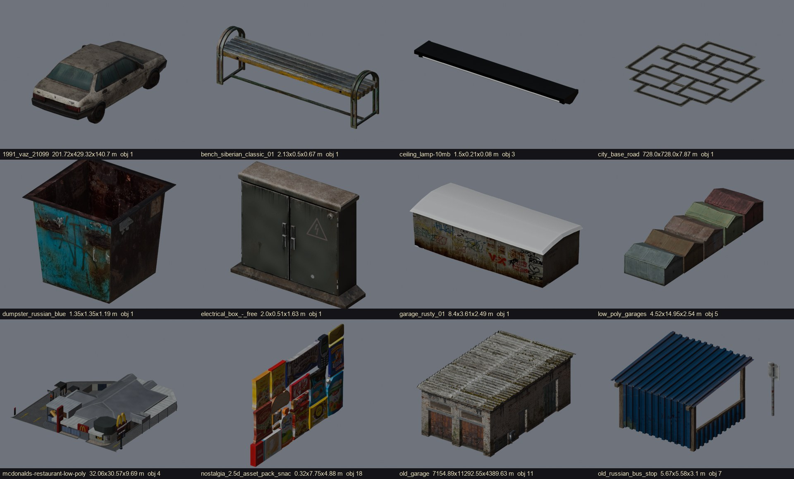
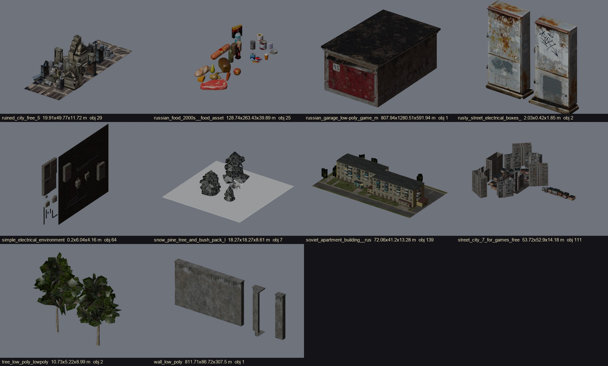
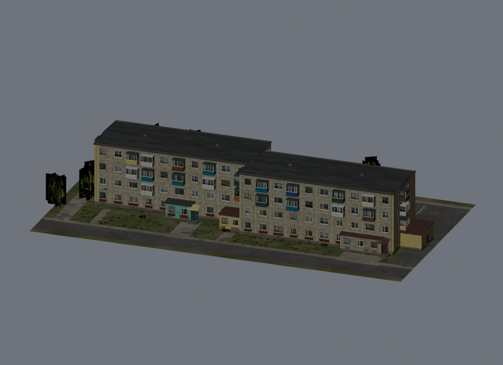
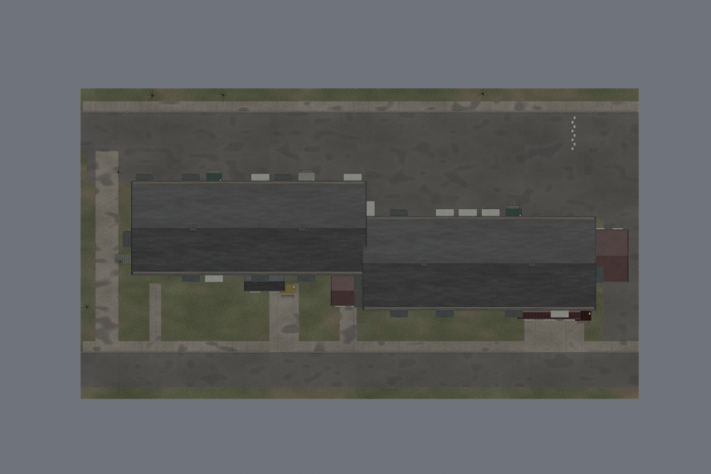
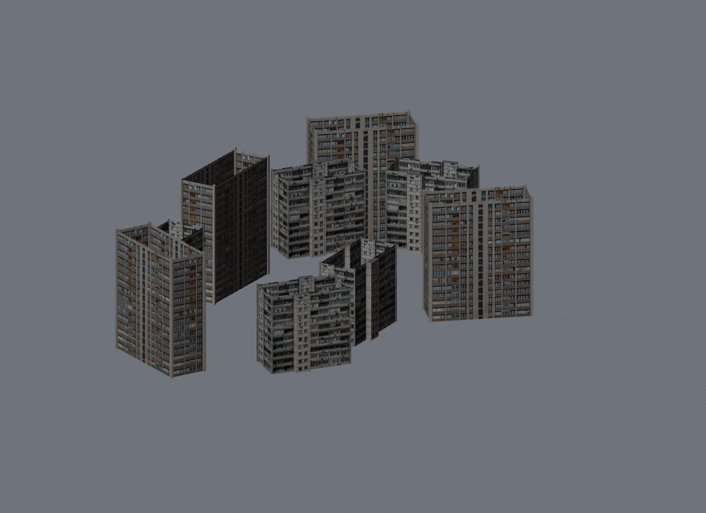
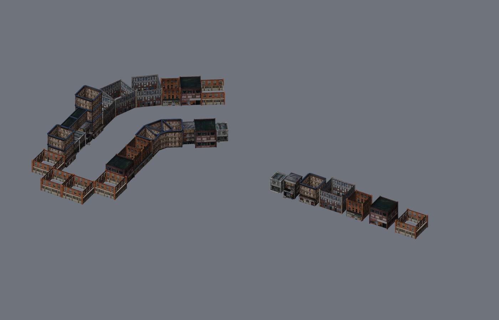
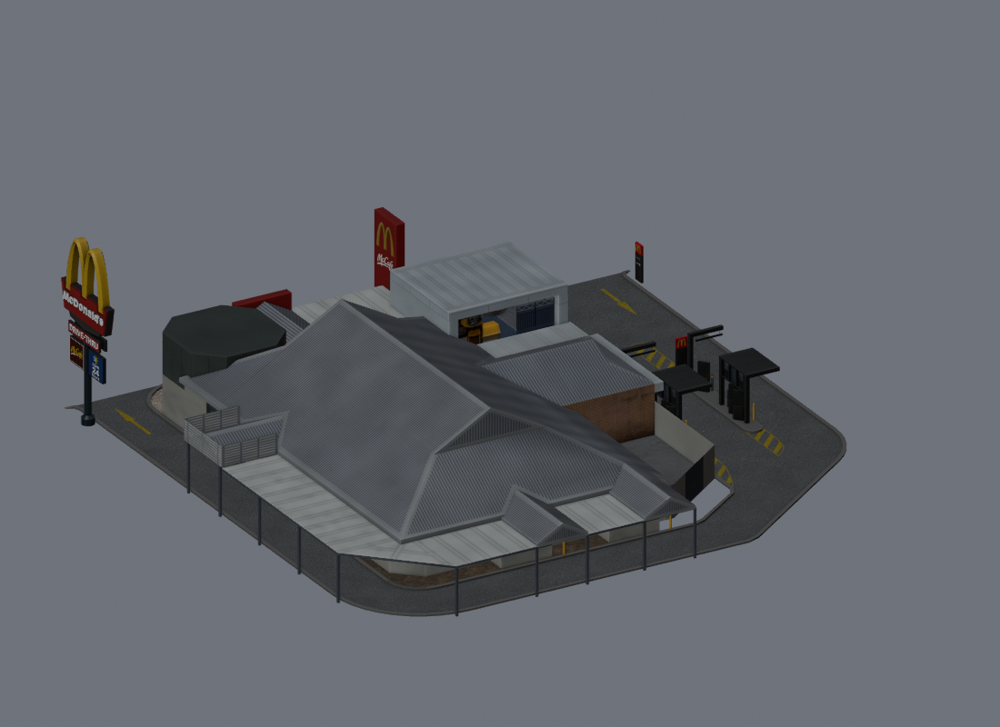
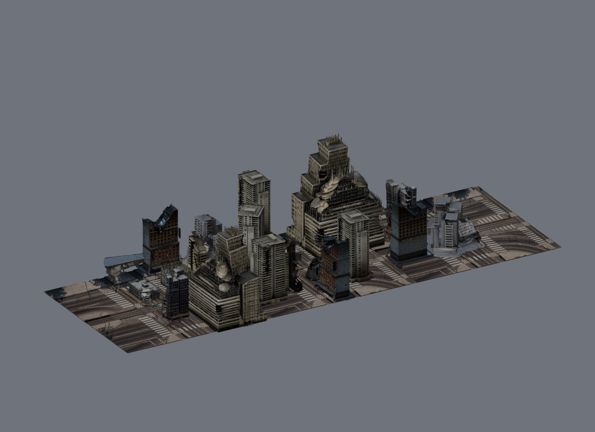
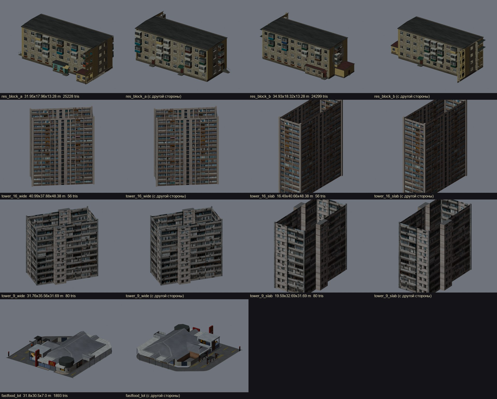
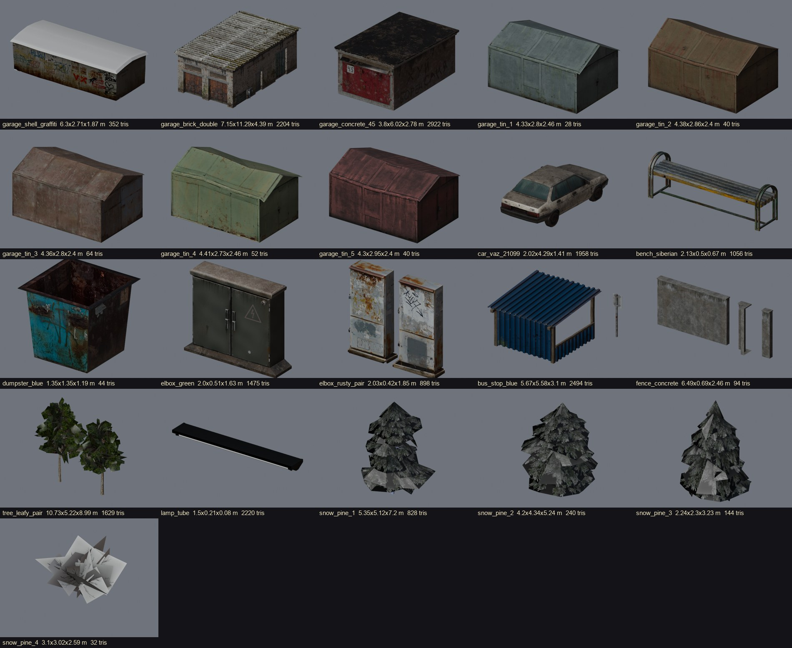

# ДВОР, редизайн — аудит 3D-моделей владельца

Источник: `C:\Users\Владос\Desktop\models\1 loc\` (23 файла GLB; `mcdonalds-restaurant-low-poly (1).glb` — побайтовая копия, не считается).
Архива `models.zip` в рабочем пространстве нет — модели взяты из этой папки. Копии исходников лежат в
`godot/assets/golda67/dvor_redesign_work/source_references/` (в git не идут), оригиналы не менялись.
Размеры, состав и лицензии сняты с самих файлов: Blender 5.3 (`tools/blender/dvor_extract.py`) и метаданные Sketchfab внутри GLB.

## 1. Лицензии — главное

Правило проекта (`CLAUDE.md`, раздел «Ассеты Sketchfab»): брать только **CC0 и CC-BY**; NonCommercial, ShareAlike, Standard — запрещены.

| Статус | Модели |
|---|---|
| Разрешено, нужна атрибуция (CC-BY 4.0) — 17 | `bench_siberian_classic_01`, `ceiling_lamp-10mb`, `city_base_road`, `dumpster_russian_blue`, `electrical_box_-_free`, `garage_rusty_01`, `low_poly_garages`, `mcdonalds-restaurant-low-poly`, `nostalgia_2.5d_asset_pack_snacks__retro_items`, `old_garage`, `old_russian_bus_stop`, `russian_food_2000s__food_asset_pack`, `russian_garage_low-poly_game_model_4k_pbr_tex`, `rusty_street_electrical_boxes_1`, `snow_pine_tree_and_bush_pack_lowpoly`, `tree_low_poly_lowpoly`, `wall_low_poly` |
| **Sketchfab Standard — 4**: в игре использовать можно, но исходные файлы нельзя распространять, а репозиторий публичный | `ruined_city_free_5`, `simple_electrical_environment`, `soviet_apartment_building__russian_far_east`, `street_city_7_for_games_free` |
| **Некоммерческая (CC-BY-NC-SA) — 1**: запрещена | `1991_vaz_21099` |
| Лицензия не установлена | нет |

Вывод: жилой дом, башни и электрика — под Standard. Пока владелец не решит, как с ними быть (вопрос 1 в сводке), эти модели
остаются только в рабочей папке и в финальную сборку не идут. Товарные знаки McDonald's — отдельный риск, не связанный с лицензией файла.

## 2. Все модели

| Файл | Что внутри | Частей | Треугольников | Материалов / текстур | МБ | Размер и масштаб | Пригодность для Двора | Где использовать | Автор, лицензия |
|---|---|---|---|---|---|---|---|---|---|
| `1991_vaz_21099` | ВАЗ-21099, грязный, без салона | 1 | 1958 | 1 / 2 | 8.7 | сантиметры → ×0,01 (2,0 × 4,3 × 1,4 м) | НЕТ: лицензия NC-SA | парковка — только после замены на разрешённую машину | [Renafox](https://sketchfab.com/3d-models/1991-vaz-21099-4a1ada9d2847461db4bc99c35194a55c), CC-BY-NC-SA-4.0 |
| `bench_siberian_classic_01` | дворовая лавка с гнутыми трубами | 1 | 1056 | 1 / 2 | 6.0 | метры, как есть | да | у подъездов, у площадки, в беседке | [randombug](https://sketchfab.com/3d-models/bench-siberian-classic-01-55daa138d3e745bca4232646c06383d5), CC-BY-4.0 |
| `ceiling_lamp-10mb` | линейный светильник | 3 | 2220 | 1 / 4 | 7.3 | метры | да | арка, гаражи, мастерская | [Mehdi Shahsavan](https://sketchfab.com/3d-models/ceiling-lamp-10mb-110718d4dbbc4b68b5d9175a8fb636ad), CC-BY-4.0 |
| `city_base_road` | сетка городских дорог 728 × 728 (условные единицы), одна сетка 34 тыс. треугольников | 1 | 33953 | 1 / 2 | 15.3 | масштаб не для двора | нет | не использовать: дороги двора проще и чище сделать своей геометрией | [AqibGulzar_41](https://sketchfab.com/3d-models/city-base-road-03212f3a69824742ad783eada8fab716), CC-BY-4.0 |
| `dumpster_russian_blue` | мусорный бак, 44 треугольника | 1 | 44 | 1 / 1 | 2.4 | метры | да | хоздвор у ТП, у гаражей | [randombug](https://sketchfab.com/3d-models/dumpster-russian-blue-203455b8624149b1a8621935ac746757), CC-BY-4.0 |
| `electrical_box_-_free` | зелёный электрошкаф | 1 | 1475 | 1 / 3 | 19.8 | метры | да | хоздвор, торцы домов | [Mathieu Godard](https://sketchfab.com/3d-models/electrical-box-free-383a234d6d80421fbe67080048cbbc70), CC-BY-4.0 |
| `garage_rusty_01` | металлический гараж в граффити, белая крыша | 1 | 352 | 1 / 1 | 1.0 | ×0,75 (6,3 × 2,7 × 1,9 м) — уточнить | да | ориентир на входе в гаражный квартал | [randombug](https://sketchfab.com/3d-models/garage-rusty-01-c35c77e531d6443187c9021c025d8eb6), CC-BY-4.0 |
| `low_poly_garages` | пять жестяных гаражей разных цветов, по 28–64 треугольника | 5 | 224 | 5 / 5 | 8.7 | метры (4,4 × 2,9 × 2,5 м) | да | ряды гаражного квартала (22 штуки) | [zubenko78](https://sketchfab.com/3d-models/low-poly-garages-129eb88e8596402f8f8d3e0d0ae9123b), CC-BY-4.0 |
| `mcdonalds-restaurant-low-poly` | ресторан с проездом, парковкой, забором и пилонами | 4 | 4537 | 4 / 6 | 12.0 | метры, участок 32 × 30 м | с оговоркой: товарные знаки McDonald's на пилонах и текстурах | вариант B; в рекомендованном плане не используется | [Dakta.Grower.Nzl](https://sketchfab.com/3d-models/mcdonalds-restaurant-low-poly-ee7f1bbe523545ffaba4def09d09d937), CC-BY-4.0 |
| `nostalgia_2.5d_asset_pack_snacks__retro_items` | 18 плоских «2.5D» карточек: чипсы, сухарики, жвачки, Nokia | 18 | 1514 | 18 / 18 | 1.9 | плоские спрайты | да (упаковки — пародии на бренды, проверить) | витрина «ШАУРМЫ 67», мусор, будущие предметы-бафы | [Vlaxled](https://sketchfab.com/3d-models/nostalgia-25d-asset-pack-snacks-retro-items-667808368b8d4c4da40feafd259f8d6f), CC-BY-4.0 |
| `old_garage` | кирпичный гараж на двое ворот, шифер, 11 частей | 11 | 2204 | 11 / 18 | 12.2 | миллиметры → ×0,001 (7,2 × 11,3 × 4,4 м) | да | «МАСТЕРСКАЯ» — крупный ориентир гаражей | [Yury Misiyuk](https://sketchfab.com/3d-models/old-garage-d665126c67ff4a8badec7864e2479d9f), CC-BY-4.0 |
| `old_russian_bus_stop` | остановка из синего профлиста, знак | 7 | 2494 | 4 / 12 | 37.5 | метры (5,7 × 5,6 × 3,1 м) | да | тротуар на востоке | [halkiridze](https://sketchfab.com/3d-models/old-russian-bus-stop-074e11d7adb9420a83bc862e81579a9f), CC-BY-4.0 |
| `ruined_city_free_5` | американские небоскрёбы и руины, 425 тыс. треугольников | 29 | 424545 | 16 / 31 | 81.5 | макет | НЕТ: чужой стиль, тяжёлый, лицензия Standard | не использовать | [dasy444](https://sketchfab.com/3d-models/ruined-city-free-5-4b0b0021d91442079a91b075576efe4e), SKETCHFAB Standard |
| `russian_food_2000s__food_asset_pack` | 25 продуктов: колбаса, хлеб, консервы, сгущёнка, бутылки | 25 | 8330 | 2 / 6 | 7.8 | условные единицы → ×0,01 | да | ларёк, беседка, будущие предметы-бафы и тайники | [DANILHELG](https://sketchfab.com/3d-models/russian-food-2000s-food-asset-pack-ad9aa4bbeadf48c189483c921ac7142a), CC-BY-4.0 |
| `russian_garage_low-poly_game_model_4k_pbr_tex` | бетонный гараж № 45, красные ворота, надписи | 1 | 2922 | 1 / 4 | 38.7 | ×0,0047 (3,8 × 6,0 × 2,8 м) | да | гараж № 45 у мастерской | [BlackMonolith](https://sketchfab.com/3d-models/russian-garage-low-poly-game-model-4k-pbr-tex-b000317cf47c40069630f24695b47826), CC-BY-4.0 |
| `rusty_street_electrical_boxes_1` | два ржавых уличных шкафа | 2 | 898 | 1 / 1 | 2.2 | метры | да | хоздвор, углы домов | [bean(alwayshasbean)](https://sketchfab.com/3d-models/rusty-street-electrical-boxes-1-7d8e1afe6e8542de8293cdf9d8c0e544), CC-BY-4.0 |
| `simple_electrical_environment` | 64 детали: щитки, счётчики, кабели, кирпичная стена-подложка | 64 | 15998 | 6 / 4 | 17.3 | метры, плоский набор у стены | НЕТ в публичный репозиторий: лицензия Standard | детали стен гаражей и арки — после решения по лицензии | [trashbinkr](https://sketchfab.com/3d-models/simple-electrical-environment-8b2d0bc5b19a448da56a7bc00e04c6d9), SKETCHFAB Standard |
| `snow_pine_tree_and_bush_pack_lowpoly` | три заснеженные ели и куст, подложка-снег | 7 | 1246 | 4 / 3 | 40.5 | метры (ели 3–7 м) | да | двор, нычка | [EFX](https://sketchfab.com/3d-models/snow-pine-tree-and-bush-pack-lowpoly-7afc4ca23dd84adea90dc0ba8506c500), CC-BY-4.0 |
| `soviet_apartment_building__russian_far_east` | два четырёхэтажных корпуса уступом, подъезды, балконы, пристройки, участок; 139 частей по типам | 139 | 52735 | 9 / 10 | 27.7 | метры (корпус 29,3 × 11,6 × 13,3 м) | ЛУЧШАЯ модель набора, но лицензия Standard | дома 67, 65, 69 — основа района | [SamopalMan](https://sketchfab.com/3d-models/soviet-apartment-building-russian-far-east-58a3498422c54fb09f808e30bbd9ae49), SKETCHFAB Standard |
| `street_city_7_for_games_free` | макет: панельные башни-оболочки (9 штук) и 38 кирпичных европейских домиков-коробок без крыш | 111 | 92967 | 12 / 12 | 17.7 | макет → башни ×3,9 (до 48 м) | башни — да, как дальний план; домики — нет (чужой стиль); лицензия Standard | горизонт за границами района | [dasy444](https://sketchfab.com/3d-models/street-city-7-for-games-free-493a69b451284ff88346c7b3e4e1b5a7), SKETCHFAB Standard |
| `tree_low_poly_lowpoly` | два лиственных дерева с летней листвой | 2 | 1629 | 1 / 1 | 0.2 | метры (9 м) | нет: лето | не использовать зимой; в игре есть голые деревья | [00amza](https://sketchfab.com/3d-models/tree-low-poly-lowpoly-73201f05280d48dcb10ed4ca362d69f8), CC-BY-4.0 |
| `wall_low_poly` | бетонная плита забора и два столба | 1 | 94 | 1 / 3 | 17.5 | ×0,008 (6,5 × 0,7 × 2,5 м) | да | северная и западная границы, дыра в заборе | [adventurer](https://sketchfab.com/3d-models/wall-low-poly-98ff2cd52fee41e09ca846e5bbd0521d), CC-BY-4.0 |

## 3. Большие наборы — что удалось достать

### `soviet_apartment_building__russian_far_east` — основа района

Модель собрана по типам деталей (стены, окна, балконы, подъезды, козырьки, пристройки, водостоки, крыша, антенны), каждая деталь — одна сетка
на оба корпуса. Корпуса стоят уступом и срослись торцами. Разрезаны на два самостоятельных дома по островам геометрии; на месте стыка
стены не было — торец закрыт зеркальной копией глухой торцевой стены того же корпуса. Участок, трава и деревья убраны.

- `res_block_a` — 32,0 × 18,0 × 13,3 м с крыльцами (тело 29,3 × 11,6 м), 25 тыс. треугольников: подъезд с бирюзовым тамбуром, жёлтая пристройка, лестница с торца;
- `res_block_b` — 34,9 × 18,3 × 13,3 м, 24 тыс. треугольников: пристройка-магазин с красной крышей, жёлтый гараж у торца, рекламные щиты на торце.

Осталось доделать при реализации: несколько балконных деталей у стыка ушли не в свой корпус; 25 тыс. треугольников на дом — много, нужны упрощённые версии для дальних домов.

### `street_city_7_for_games_free`

Это макет в масштабе примерно 1:4. Башни — плоские оболочки из четырёх стен без крыш и перекрытий (56–80 треугольников): вблизи и сверху не годятся,
как горизонт за забором — хороши. Достаны четыре вида: `tower_16_wide`, `tower_16_slab`, `tower_9_wide`, `tower_9_slab` (увеличены в 3,9 раза, до 32–48 м).
Кирпичные домики — европейская улица с магазинами, пустые коробки без крыш: в сибирский двор не подходят, не использованы.

### `mcdonalds-restaurant-low-poly`

Четыре сетки: здание с участком, проезд, забор и пилоны с логотипами. `fastfood_lot` — без пилонов; логотипы остались на текстурах крыши и фасада.
Использовать можно только после перекраски под вымышленную сеть. Участок 32 × 30 м занимает треть ширины района — поэтому стоит только в варианте B.

### `ruined_city_free_5`

Небоскрёбы и обломки, 425 тыс. треугольников, Standard. Не подходит ни по стилю, ни по весу.

### `simple_electrical_environment`, `old_garage`, `low_poly_garages`, `old_russian_bus_stop`

Электрика — плоский набор щитков и кабелей на кирпичной стене (деталь для стен, не здание). Кирпичный гараж, остановка и пять жестяных гаражей достаны целиком.

## 4. Библиотека частей

`godot/assets/golda67/dvor_redesign_work/architecture_parts/` — 28 частей в метрах, низ на нуле, центр основания в начале координат; список и размеры — `library.json`,
превью — `previews/`. В папке лежит `.gdignore`: Godot её не импортирует, игра не меняется.

| Часть | Раздел | Размер, м | Треугольников | МБ | Источник | Заметка |
|---|---|---|---|---|---|---|
| `res_block_a` | buildings | 31.95 × 17.96 × 13.28 | 25228 | 13.2 | `soviet_apartment_building__russian` | четырёхэтажка, западный корпус |
| `res_block_b` | buildings | 34.93 × 18.32 × 13.28 | 24299 | 13.1 | `soviet_apartment_building__russian` | четырёхэтажка, восточный корпус |
| `tower_16_wide` | buildings | 40.99 × 37.88 × 48.38 | 56 | 0.2 | `street_city_7_for_games_free` | панельная башня-оболочка: только дальний план за границей района |
| `tower_16_slab` | buildings | 16.49 × 40.66 × 48.38 | 56 | 0.2 | `street_city_7_for_games_free` | панельная башня-оболочка: только дальний план за границей района |
| `tower_9_wide` | buildings | 31.76 × 35.56 × 31.69 | 80 | 7.9 | `street_city_7_for_games_free` | панельная башня-оболочка: только дальний план за границей района |
| `tower_9_slab` | buildings | 19.59 × 32.69 × 31.69 | 80 | 7.9 | `street_city_7_for_games_free` | панельная башня-оболочка: только дальний план за границей района |
| `fastfood_lot` | buildings | 31.8 × 30.5 × 7.0 | 1893 | 11.5 | `mcdonalds-restaurant-low-poly` | ресторан с проездом и забором; пилоны с логотипом сняты |
| `garage_shell_graffiti` | garages | 6.3 × 2.71 × 1.87 | 352 | 1.0 | `garage_rusty_01` | металлический гараж в граффити |
| `garage_brick_double` | garages | 7.15 × 11.29 × 4.39 | 2204 | 12.2 | `old_garage` | кирпичный бокс на двое ворот, шиферная крыша |
| `garage_concrete_45` | garages | 3.8 × 6.02 × 2.78 | 2922 | 38.7 | `russian_garage_low-poly_game_model` | бетонный гараж № 45, красные ворота |
| `garage_tin_1` | garages | 4.33 × 2.8 × 2.46 | 28 | 1.6 | `low_poly_garages` | жестяной гараж, цвет 1 |
| `garage_tin_2` | garages | 4.38 × 2.86 × 2.4 | 40 | 1.7 | `low_poly_garages` | жестяной гараж, цвет 2 |
| `garage_tin_3` | garages | 4.36 × 2.8 × 2.4 | 64 | 1.9 | `low_poly_garages` | жестяной гараж, цвет 3 |
| `garage_tin_4` | garages | 4.41 × 2.73 × 2.46 | 52 | 1.7 | `low_poly_garages` | жестяной гараж, цвет 4 |
| `garage_tin_5` | garages | 4.3 × 2.95 × 2.4 | 40 | 1.7 | `low_poly_garages` | жестяной гараж, цвет 5 |
| `car_vaz_21099` | props | 2.02 × 4.29 × 1.41 | 1958 | 8.6 | `1991_vaz_21099` | ВАЗ-21099 |
| `bench_siberian` | props | 2.13 × 0.5 × 0.67 | 1056 | 6.0 | `bench_siberian_classic_01` | лавка |
| `dumpster_blue` | props | 1.35 × 1.35 × 1.19 | 44 | 2.4 | `dumpster_russian_blue` | мусорный бак |
| `elbox_green` | props | 2.0 × 0.51 × 1.63 | 1475 | 19.8 | `electrical_box_-_free` | электрошкаф |
| `elbox_rusty_pair` | props | 2.03 × 0.42 × 1.85 | 898 | 2.2 | `rusty_street_electrical_boxes_1` | два ржавых шкафа |
| `bus_stop_blue` | streets | 5.67 × 5.58 × 3.1 | 2494 | 37.4 | `old_russian_bus_stop` | остановка из профлиста со знаком |
| `fence_concrete` | walls | 6.49 × 0.69 × 2.46 | 94 | 19.4 | `wall_low_poly` | бетонная плита забора и два столба |
| `tree_leafy_pair` | props | 10.73 × 5.22 × 8.99 | 1629 | 0.2 | `tree_low_poly_lowpoly` | два лиственных дерева (летние) |
| `lamp_tube` | props | 1.5 × 0.21 × 0.08 | 2220 | 7.2 | `ceiling_lamp-10mb` | линейный светильник |
| `snow_pine_1` | props | 5.35 × 5.12 × 7.2 | 828 | 40.3 | `snow_pine_tree_and_bush_pack_lowpo` | заснеженная ель или куст |
| `snow_pine_2` | props | 4.2 × 4.34 × 5.24 | 240 | 40.3 | `snow_pine_tree_and_bush_pack_lowpo` | заснеженная ель или куст |
| `snow_pine_3` | props | 2.24 × 2.3 × 3.23 | 144 | 1.8 | `snow_pine_tree_and_bush_pack_lowpo` | заснеженная ель или куст |
| `snow_pine_4` | props | 3.1 × 3.02 × 2.59 | 32 | 0.2 | `snow_pine_tree_and_bush_pack_lowpo` | заснеженная ель или куст |

Разделы `facades`, `entrances`, `roofs` пока пусты: дом режется на корпуса целиком, отдельные фасады и подъезды для рекомендованного плана не понадобились.
