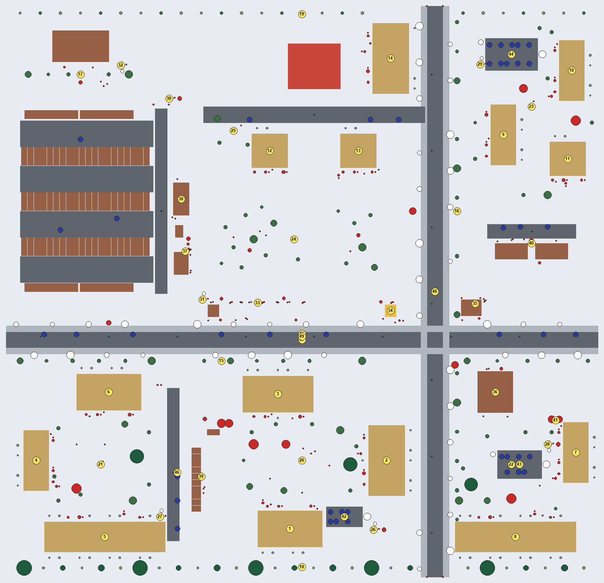

# ДВОР — правила расстановки декораций

Решение владельца (2026-11-25): **никакого случайного разброса.** Прежняя расстановка (случайные точки внутри прямоугольников дворов) удалена из сцены целиком.

## Как устроено теперь

- Все предметы заданы в одном файле — `tools/dvor_props.py`. В нём нет ни одного случайного числа: только явные координаты и правила кластеров
  (ряд с шагом, карманы парковки, смещения от двери подъезда). Единственное, что меняется по номеру предмета, — поворот дерева вокруг своей оси.
- Файл пишет `topdown_layout/DVOR_PROPS.json`; сцена `tools/blender/dvor_scene_v3.py` ставит предметы только из него.
- Перед записью каждая точка проверяется: не в доме, не на проезжей части (кроме машин и люков), не на тропе и не на маршруте (машины тоже), не вплотную к соседу, не перед точкой съёмки.
  Последнее слово — за проходом телом-ботом в Godot (`-- --dvor2view`): он нашёл то, что правила по координатам пропустили.
  Что не прошло — выбрасывается и печатается с причиной.
- Сейчас в районе **609 предметов в 52 кластерах**; проверку не прошли и убраны 33.

Оговорка: пятна наледи на проездах ставятся в сцене с разбросом внутри полотна проезда. Это не предметы, а рисунок поверхности; при сборке в игре их заменит текстура.

## Карта

Жёлтые номера — кластеры из таблицы. Зелёное — деревья и кусты, синее — машины, белое — сугробы, чёрное — баки, красное — прочие предметы.

## Правила по типам

| Что | Где стоит | Чего не делаем |
|---|---|---|
| Лавки | у двери подъезда сбоку от входа, у площадок, под навесом | не посреди газона и не спиной к двери |
| Урны | в метре-двух от лавки, у ларьков и остановки | не отдельно от места, где сидят или едят |
| Доски объявлений, шкафы | у подъезда, вдоль стены | не на тропе |
| Баки | на краю двора у проезда — чтобы подъехал мусоровоз; рядом мешки, сугроб, иногда старый диван | не посреди двора и не на главном маршруте |
| Машины | в карманах парковок носом к краю; вдоль бордюра улицы; с одной стороны дворового проезда | не поперёк проезда, не на тротуаре |
| Деревья | рядами вдоль улиц; кольцом по краю двора, вокруг площадки; рощицами на пустыре по сторонам тропы | не на тропах, проездах и площадках |
| Кусты | ровным рядом вдоль фасадов с разрывами у дверей; вдоль заборов | не перед входом в арку |
| Сугробы | валом между тротуаром и дорогой через 9 м; в конце парковок; у баков | не в разрывах у проездов, остановки и перекрёстка |
| Покрышки, бочки, поддоны | у ворот гаражей, у мастерской, у шиномонтажа | не во дворах жилых домов |
| Ящики и коробки | за киосками и у задней двери магазина | не перед окном выдачи: там очередь |
| Детское | ракеты, снеговики, санки — на площадках и у школы | не у гаражей |
| Бельё | между домом и площадкой, вдоль фасада | не над тропой |
| Люки | по оси полос на улицах через равные промежутки | — |
| Бетонные блоки | поперёк въездов, которые должны быть закрыты для машин; по краям арки | не на пешеходных тропах |

## Плотность

| Зона | Плотность | Почему |
|---|---|---|
| рынок, задворки ларьков, мастерская, шиномонтаж, гаражный двор | плотно | рабочие и торговые места — там копится хлам |
| подъезды, площадки | средне | бытовые мелочи у дверей |
| пустырь, стадион, пространство у коробки | свободно | открытые места, обзор на ориентиры и место для боя |
| проход между башнями, главная тропа, арка | пусто | маршрут и видимость входа |

## Кластеры

| № | Кластер | Центр (X; Y) | Предметов | Правило расстановки |
|---|---|---|---|---|
| 1 | подъезды H1 | -6; -118 | 13 | лавка, урна и доска объявлений у каждой двери; санки и клумба — через одну |
| 2 | подъезды H2 | 42; -84 | 13 | лавка, урна и доска объявлений у каждой двери; санки и клумба — через одну |
| 3 | подъезды H3 | -12; -51 | 13 | лавка, урна и доска объявлений у каждой двери; санки и клумба — через одну |
| 4 | подъезды H4 | -132; -84 | 12 | лавка, урна и доска объявлений у каждой двери; санки и клумба — через одну |
| 5 | подъезды H5 | -98; -122 | 21 | лавка, урна и доска объявлений у каждой двери; санки и клумба — через одну |
| 6 | подъезды H6 | -96; -50 | 11 | лавка, урна и доска объявлений у каждой двери; санки и клумба — через одну |
| 7 | подъезды H7 | 136; -80 | 12 | лавка, урна и доска объявлений у каждой двери; санки и клумба — через одну |
| 8 | подъезды H8 | 106; -122 | 22 | лавка, урна и доска объявлений у каждой двери; санки и клумба — через одну |
| 9 | подъезды P1 | 100; 78 | 10 | лавка, урна и доска объявлений у каждой двери; санки и клумба — через одну |
| 10 | подъезды P2 | 134; 110 | 12 | лавка, урна и доска объявлений у каждой двери; санки и клумба — через одну |
| 11 | подъезды TC | 132; 66 | 10 | лавка, урна и доска объявлений у каждой двери; санки и клумба — через одну |
| 12 | подъезды TA | -16; 70 | 8 | лавка, урна и доска объявлений у каждой двери; санки и клумба — через одну |
| 13 | подъезды TB | 28; 70 | 11 | лавка, урна и доска объявлений у каждой двери; санки и клумба — через одну |
| 14 | подъезды H9 | 44; 116 | 10 | лавка, урна и доска объявлений у каждой двери; санки и клумба — через одну |
| 15 | аллея улицы Облачной | -40; -34.5 | 17 | ряд деревьев между тротуаром и дворами, разрывы у проездов и троп |
| 16 | аллея улицы Битной | 77; 40 | 14 | ряд деревьев вдоль восточного тротуара |
| 17 | аллея у школы | -110; 108 | 11 | ряд деревьев перед школой, памятник на оси входа |
| 18 | ветрозащита у железной дороги | 0; -137 | 28 | сплошной ряд елей и кустов вдоль насыпи |
| 19 | кусты у северного забора | 0; 138 | 25 | ряд вдоль бетонного забора |
| 20 | двор Пахана | 0; -84 | 16 | площадка в центре: горка, качели, ракета, снеговики; деревья кольцом вокруг; бельё у дома 69; ели у дома 65 |
| 21 | двор 71–75 | -100; -86 | 12 | качели, ракета и беседка; деревья вдоль домов; бельё у дома 73 |
| 22 | двор 61–63 | 104; -86 | 10 | горка и качалка у парковки; деревья по краю; бельё у дома 63 |
| 23 | двор панелек | 114; 92 | 11 | качели, горка, ракета, беседка; деревья между домами |
| 24 | пустырь | -4; 26 | 21 | две рощицы по сторонам тропы, брёвна и пни; тропа свободна |
| 25 | у беседки-передышки | -34; 80 | 5 | беседка перед башнями: магнитофон на полу, деревья за спиной |
| 26 | мусорка двора Пахана | 33.5; -106.5 | 8 | два бака у проезда (подъезд мусоровоза), мешки рядом, сугроб от расчистки, выброшенный диван |
| 27 | мусорка двора 71–75 | -70.5; -112 | 7 | два бака у проезда (подъезд мусоровоза), мешки рядом, сугроб от расчистки |
| 28 | мусорка двора 61–63 | 122; -76 | 8 | два бака у проезда (подъезд мусоровоза), мешки рядом, сугроб от расчистки, выброшенный диван |
| 29 | мусорка двора панелек | 88.5; 113 | 7 | два бака у проезда (подъезд мусоровоза), мешки рядом, сугроб от расчистки |
| 30 | мусорка ГСК | -66; 96 | 7 | два бака у проезда (подъезд мусоровоза), мешки рядом, сугроб от расчистки, выброшенный диван |
| 31 | мусорка рынка | -49.5; -4 | 7 | два бака у проезда (подъезд мусоровоза), мешки рядом, сугроб от расчистки |
| 32 | мусорка школы | -90; 112.5 | 7 | два бака у проезда (подъезд мусоровоза), мешки рядом, сугроб от расчистки |
| 33 | рынок: задворки киосков | -22; -5.6 | 30 | за каждым киоском — коробки и ящики с товаром; поддоны; бочка-печка у торговцев; бак и почта у входа |
| 34 | «ШАУРМА 67» | 44; -9.5 | 7 | место очереди перед окном свободно; за ларьком ящики и поддоны; бак сбоку; почтовый ящик у остановки |
| 35 | шиномонтаж и Молния | 86; -6 | 9 | стопка покрышек у ворот, бочка-печка, поддоны; Молния стоит у бокса |
| 36 | «ПРОДУКТЫ 24» | 96; -50 | 6 | разгрузка сзади: поддоны и коробки; почтовый ящик и урна у входа |
| 37 | мастерская ГСК | -58; 20 | 9 | рабочий угол мастера: покрышки, бочки, печка, поддоны, диван для перекура |
| 38 | открытый блок № 64 | -60; 46 | 3 | покрышки у ворот, бочка за углом |
| 39 | гаражи у дома Пахана | -50; -92 | 6 | покрышки и бочка у ворот; ракушки и диван у гаража в граффити |
| 40 | гаражный двор у башен | 114; 24 | 7 | территория смотрящего: диван, печка, бочки, покрышки, поддоны, «буханка» |
| 41 | ракушки двора 61–63 | 126; -64 | 2 | две жестяные ракушки у торца дома |
| 42 | парковка двора Пахана | 21; -112 | 7 | машины носом к краю, по разметке карманов; в конце — вал снега от расчистки |
| 43 | парковка двора 61–63 | 108; -86 | 9 | машины носом к краю, по разметке карманов; в конце — вал снега от расчистки |
| 44 | парковка двора панелек | 104; 118 | 12 | машины носом к краю, по разметке карманов; в конце — вал снега от расчистки |
| 45 | машины вдоль улицы Облачной | 0; -21 | 9 | припаркованы у северного бордюра, вне остановки и перекрёстка |
| 46 | машины в проездах | -62; -90 | 18 | вдоль дворовых проездов с одной стороны, чтобы оставался проезд |
| 47 | снежные валы улицы Облачной | 0; -24 | 23 | вал вдоль обоих бордюров через 9 м; разрывы у остановки, перекрёстка, проездов и троп |
| 48 | снежные валы улицы Битной | 66; 0 | 22 | вал вдоль обоих бордюров через 9 м |
| 49 | люки | 0; -22.4 | 22 | по оси полос на улицах через равные промежутки; по одному в каждом проезде |
| 50 | бетонные блоки | по району | 10 | закрывают сквозной проезд во дворы и тупики улиц; два — по краям арки |
| 51 | щиты | по району | 3 | советские — на улице у дворов; рекламные — у перекрёстка и на въездах |
| 52 | вороны | по району | 7 | у еды и мусора: рынок, ларёк, лавки |

## Что проверено и что нет

Проверено: автоматические правила (дом, дорога, тропа, сосед) и 28 кадра с уровня глаз и сверху, просмотренные глазами.
Не проверено: каждый двор с четырёх сторон — смотрел по одному-двум ракурсам на двор; навигация жителей и ширина проходов в игре — район в игре не собран.
