# ДВОР, редизайн — план сверху

Фаза 1: только география и композиция. Боёв, бафов, порталов и маркеров здесь нет — отмечены лишь места, куда их
можно будет встроить. Планы строит `tools/dvor_plan.py` (PNG, SVG и раскладка для блокаута из одного описания),
блокаут — `tools/blender/dvor_blockout.py`.

## 1. Координаты

- Единицы — метры. На плане **X — восток, Y — север**. В Godot: `x = X`, `z = −Y`.
- Начало координат — центр двора-колодца. Сетка на планах — 10 м.
- Размеры домов, гаражей и реквизита сняты с настоящих моделей (`architecture_parts/library.json`).

## 2. Вариант A — компактный квартал «КОЛОДЕЦ» (рекомендуется)

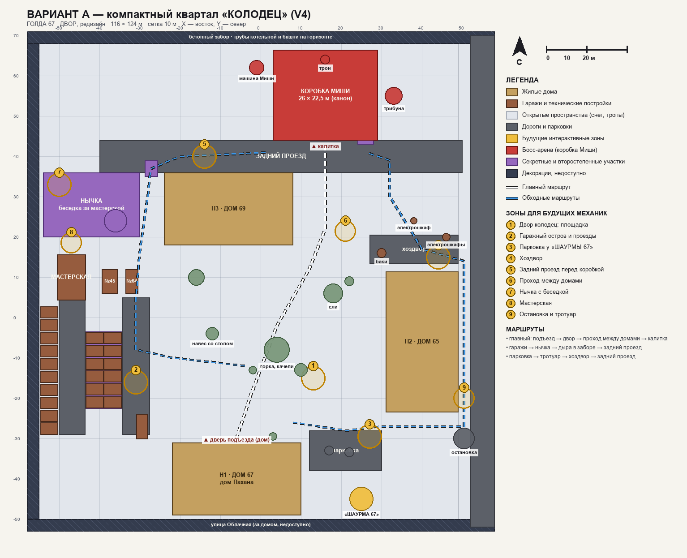

**116 × 124 м**, вытянут с юга на север. Три дома замыкают двор-колодец; на западе — гаражный квартал, на востоке —
улица, на севере за домом с аркой — задний двор с коробкой Миши.

### Постройки

| Id | Что | Центр (X, Y) | Основание, м | Модель | Роль |
|---|---|---|---|---|---|
| H1 | Дом 67 — дом Пахана | (−6, −40) | 32 × 18, высота 13,3 | `res_block_a` | старт: дверь подъезда на северной стороне, выход сразу во двор |
| H2 | Дом 65 | (40, −6) | 18 × 35 | `res_block_b`, повёрнут | отделяет двор от улицы; торец с рекламой смотрит на остановку |
| H3 | Дом 69 | (−8, 27) | 32 × 18 | `res_block_a` с другим оттенком | северная стена колодца, закрывает коробку от двора |
| H3A | Секция с аркой | (16, 27) | 15,2 × 9, высота 13,6 | `g67_house_arch` (есть в игре) | главный проход к Мише; над аркой — растяжка турнира |
| GW | Западный ряд гаражей, 10 штук | X = −52,5; Y от −27,5 до 1,3 | 4,4 × 2,9 каждый | `garage_tin_1…5` | стена квартала, ворота на восток |
| GI | Гаражный остров, 2 × 6 штук спина к спине | X = −41,2 и −36,8; Y от −21 до −5 | 8,8 × 19,2 | `garage_tin_1…5` | делит квартал на два проезда; по крышам — верхний путь |
| G_SHELL | Гараж в граффити | (−29,5, −27) | 2,7 × 6,3 | `garage_shell_graffiti` | ориентир у входа в гаражи со двора |
| G_BRICK | «МАСТЕРСКАЯ» | (−47, 10) | 7,2 × 11,3, высота 4,4 | `garage_brick_double` | самый крупный объём гаражей; за ней — нычка |
| G_45 | Гараж № 45 | (−37,5, 9) | 3,8 × 6 | `garage_concrete_45` | красные ворота видны через весь проезд |
| G_64 | Открытый бокс № 64 | (−32, 9) | 4,2 × 3,6 | `g67_garage_open` (есть в игре) | кладовка по канону |
| TP | Трансформаторная будка | (38, 24) | 5 × 4,4 | `transformer_booth` (есть в игре) | центр хоздвора |
| COURT | Коробка Миши | (16, 55,2) | 26 × 22,5 | борта и калитка есть в игре | арена босса; трон у северного борта, трибуна с востока, машина Миши с запада |

### Открытые места

| Место | Границы | Что там |
|---|---|---|
| Двор-колодец | X −24…31, Y −31…18 (55 × 49 м) | детская площадка с ракетой (4, −8), ковровыбивалка и вешалка (−10, −4), лавка у подъезда, ели |
| Гаражные проезды | западный X −50…−43,5; восточный X −34,5…−27,5; Y −29…5 | два параллельных проезда по 7 м, соединены с юга и с севера — кольцо вокруг острова |
| Парковка у «ШАУРМЫ 67» | X 12…30, Y −38…−28; ларёк (25, −45) | машины, очередь у окна, выход на тротуар |
| Тротуар и остановка | X 49…52 вдоль всей восточной стороны; остановка (50,5, −30) | дорога X 52…58 — декорация, по ней ездят машины |
| Хоздвор | X 27…49, Y 13,5…30 | баки, электрошкафы, ТП |
| Задний проезд | X −40…50, Y 36…44 | полоса между домом 69 и коробкой; калитка коробки (16, 44) |
| Нычка | X −54…−30, Y 20…36 | беседка за мастерской; со двора не видна |

### Маршруты

1. **Главный** (белый пунктир): дверь подъезда → через двор мимо площадки → арка → калитка коробки. Около 85 м, цель видна
   почти сразу: прожекторы коробки светят над домом 69, растяжка висит над аркой.
2. **Через гаражи** (синий): двор → восточный гаражный проезд → мимо боксов № 45 и № 64 → нычка с беседкой → дыра в бетонном
   заборе (−27, 37) → задний проезд с западной стороны. Узкий, с закутками; здесь же верхний путь по крышам острова.
3. **По улице** (синий): парковка → тротуар мимо остановки → хоздвор → задний проезд с востока, к трибуне.

Все три сходятся в заднем проезде перед коробкой. Между собой они связаны ещё в трёх местах: южный и северный концы
гаражных проездов, юго-восточный угол двора (парковка) и северо-восточный (хоздвор). Тупик один, и он намеренный — нычка.

### Ориентиры

| Откуда видно | Ориентир |
|---|---|
| весь двор | прожекторы коробки над крышей дома 69 и растяжка над аркой — «туда к Мише» |
| двор, парковка | световой короб «ШАУРМА 67» на юго-востоке |
| двор, гаражи | красные ворота № 45 и шиферная крыша мастерской |
| улица | синяя остановка, торец дома 65 с рекламными щитами |
| старт | бирюзовый тамбур подъезда дома 67 — «дом» |
| отовсюду | панельные башни на горизонте: 16-этажки на севере, 9-этажки на западе и востоке |

### Места для будущих механик (не утверждены, только география)

| № | Место | Чем удобно |
|---|---|---|
| 1 | Двор-колодец | самая большая открытая площадь, 55 × 49 м, с препятствием-площадкой в центре |
| 2 | Гаражный остров и проезды | кольцо с двумя узкими проездами и крышами — засады, обходы |
| 3 | Парковка у «ШАУРМЫ 67» | машины как укрытия, рядом торговое место |
| 4 | Хоздвор у ТП | тесный угол с баками |
| 5 | Задний проезд | длинная полоса 90 × 8 м перед ареной |
| 6 | Арка | бутылочное горлышко 4 м |
| 7 | Нычка с беседкой | спрятанное тихое место |
| 8 | Мастерская | единственное здание, куда можно зайти внутрь (двое ворот) |
| 9 | Остановка и тротуар | место для приезжающих и уезжающих |

### Сильные и слабые стороны

- Плюсы: читается с первого взгляда; три разных по характеру маршрута; коробка спрятана и открывается через арку; мало пустоты;
  камере от третьего лица есть за что зацепиться; все канонические места на месте.
- Минусы: дом 69 — тот же корпус, что дом 67 (нужен другой оттенок и детали или вторая модель дома); улица узкая; фастфуда нет.

## 3. Вариант B — открытый район «УЛИЦА И ПУСТЫРЬ»

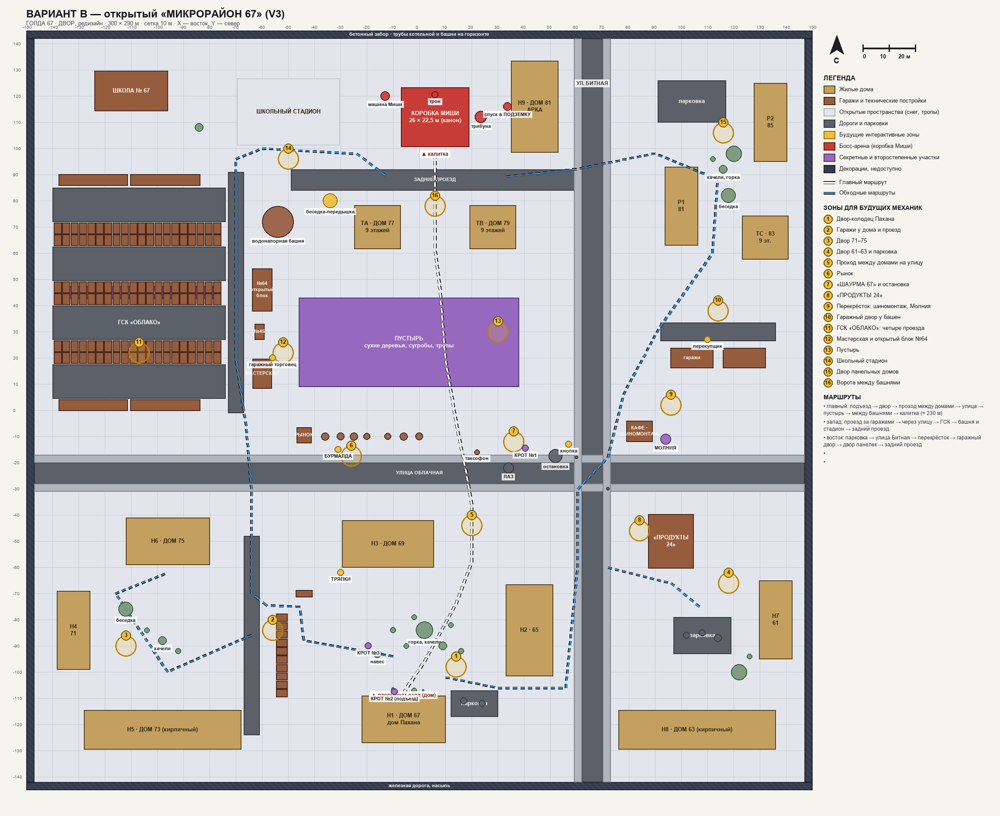

**156 × 116 м**, вытянут с запада на восток. Улица идёт вдоль всей южной стороны; дома стоят свободно; коробка — на открытом
пустыре в северо-восточном углу.

| Id | Что | Центр (X, Y) | Основание, м |
|---|---|---|---|
| H1 | Дом 67 — дом Пахана | (−8, −30) | 32 × 18 |
| H2 | Дом 65 | (62, −8) | 18 × 35 |
| H4 | Дом 71 | (−62, 14) | 18 × 32 |
| FF | Фастфуд с проездом | (−55, −27) | 32 × 30 |
| PARK | Большая парковка, «ШАУРМА 67» на углу (18, −41) | (31, −31) | 34 × 24 |
| GN, GS | Гаражный проезд: 17 гаражей по северу и 8 напротив | Y = 50 и 38,5 | проезд 62 × 7 |
| G_BRICK, G_45, G_64 | Мастерская, № 45, бокс № 64 | (−6, 46), (−20, 37,5), (−14, 37,5) | — |
| COURT | Коробка Миши | (34, 34) | 26 × 22,5 |

Маршруты: главный — подъезд → двор → пустырь → калитка (около 70 м по открытому месту); через беседку и гаражный проезд
к коробке с запада; через парковку вдоль дома 65 и хоздвор — с востока.

- Плюсы: яркий ориентир-фастфуд; настоящая улица; длинные виды; больше места для машин и толпы.
- Минусы: в полтора раза больше площадь при том же числе интересных мест — много бега по пустому снегу; коробка видна сразу,
  без подводки; фастфуд чужой по стилю и с чужими товарными знаками; нужен третий дом; тяжелее по кадру (всё видно сразу).

## 4. Рекомендация

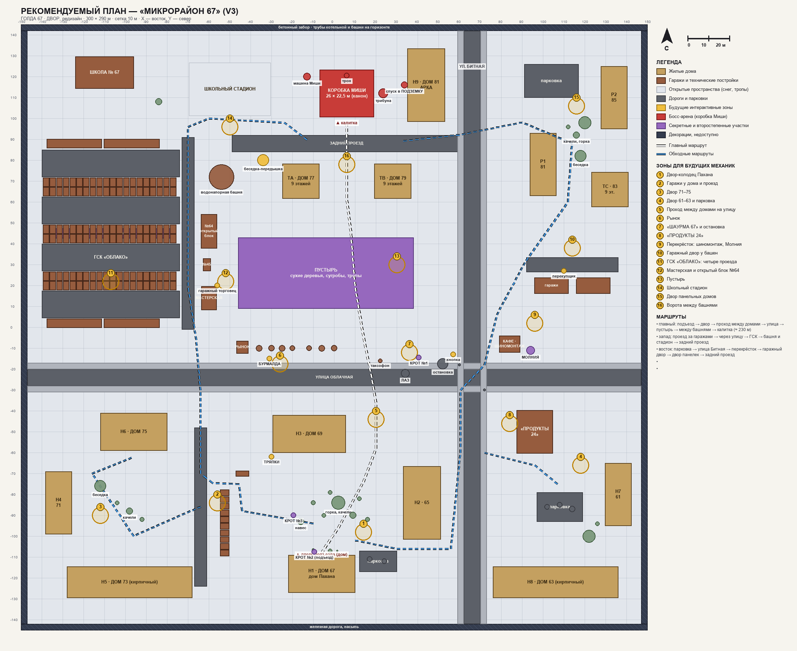

**Вариант A.** Он плотнее, в нём есть драматургия (двор → арка → арена), три маршрута отличаются на ощупь, и он собирается из
уже имеющихся моделей. Из варианта B стоит забрать одну идею: если владельцу нужен фастфуд, его можно поставить за дорогой
на востоке как декорацию и ориентир, не раздувая район.

## 5. 3D-блокаут рекомендованного варианта

Сцена: `godot/assets/golda67/dvor_redesign_work/blender_source/dvor_blockout.blend` (собирается скриптом, в git не идёт).
Это прототип композиции: настоящие модели на своих местах, без снега на крышах, света, заборов между зонами и мелких деталей.

| Вид | Кадр |
|---|---|
| С юга, общий | 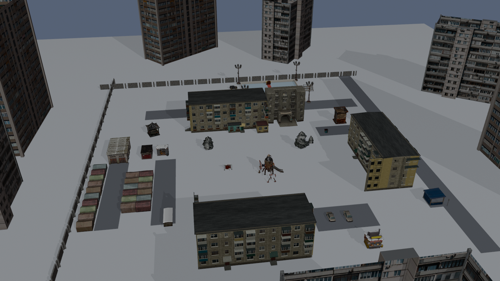 |
| С северо-востока: задний двор и коробка | 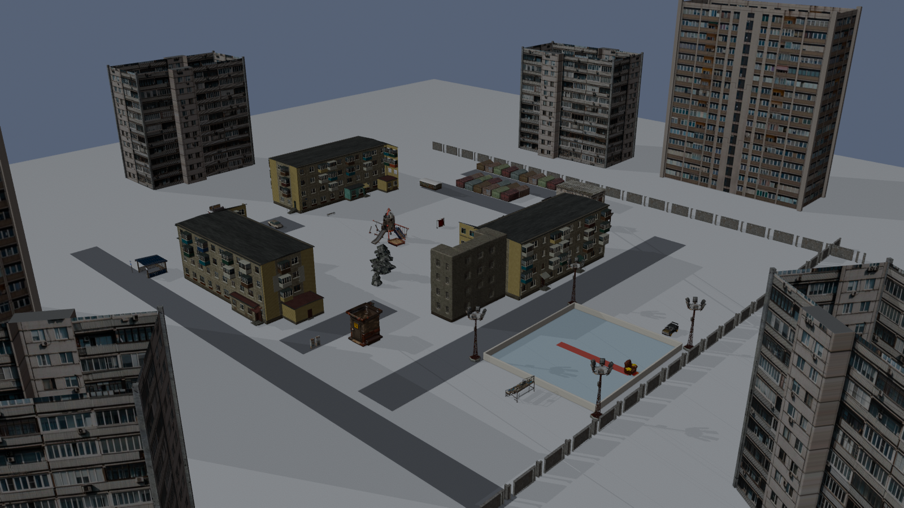 |
| С запада: гаражи | 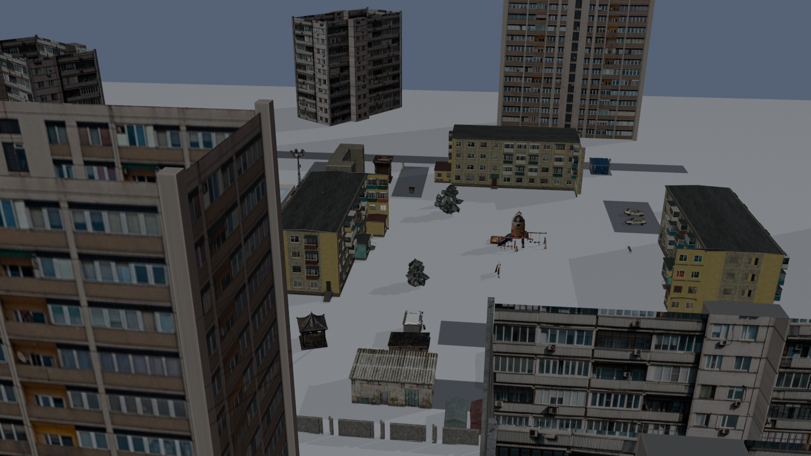 |
| Сверху | 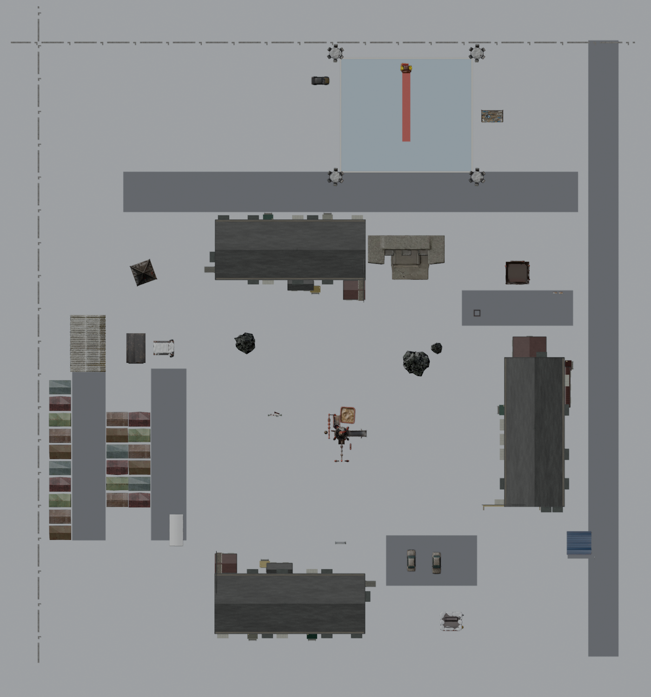 |
| От двери подъезда | 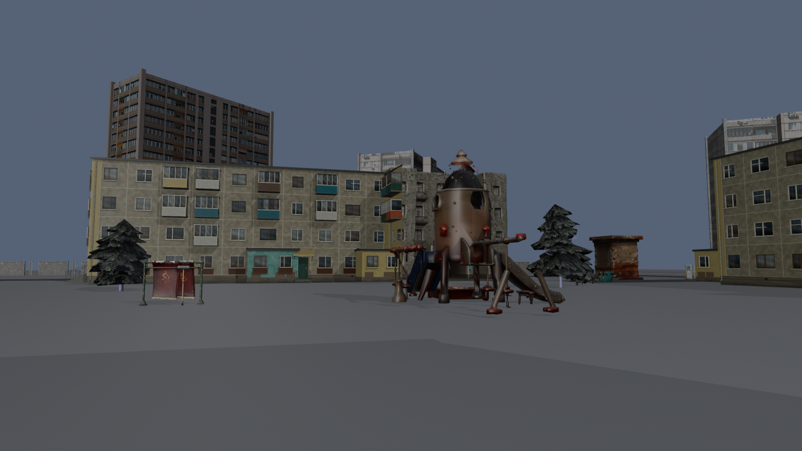 |
| К арке | 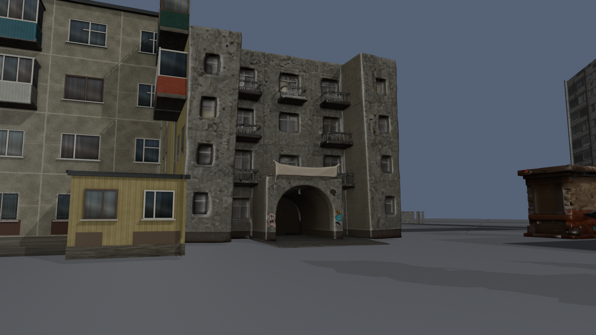 |
| Гаражный проезд | 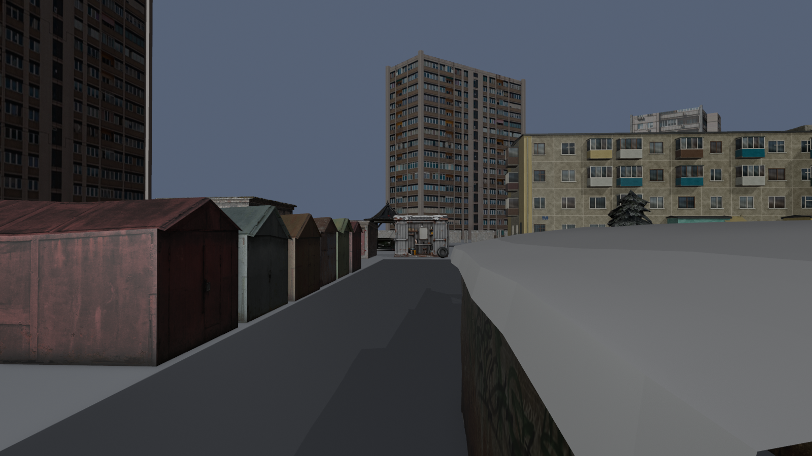 |
| Задний проезд, коробка | 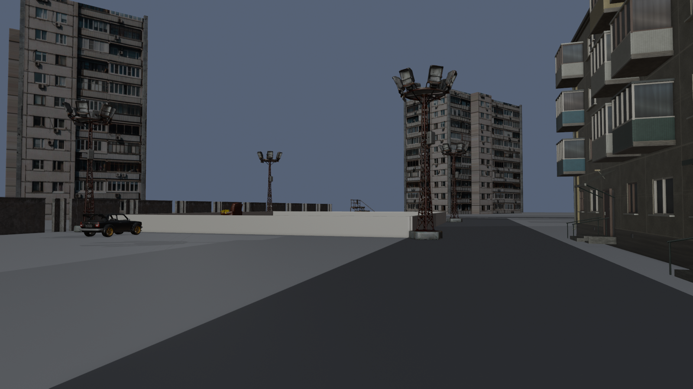 |
| Угол у «ШАУРМЫ 67» | 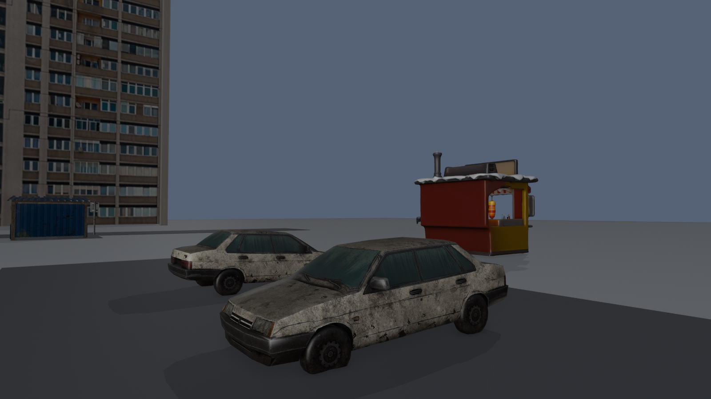 |
| Коробка от калитки | 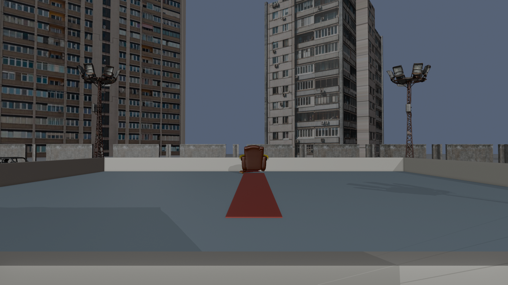 |
| Нычка | 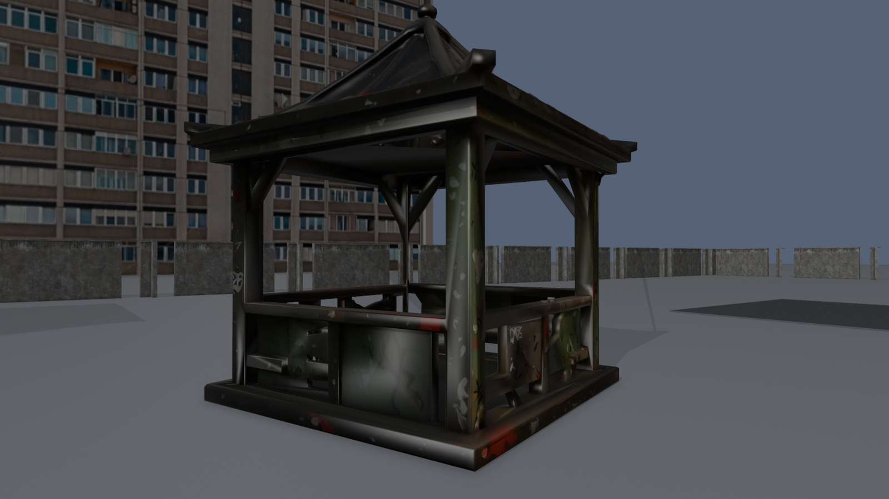 |

Что видно по блокауту и надо поправить на следующем шаге: башни горизонта стоят слишком близко и давят — отодвинуть на 40–60 м;
ларёк и ели мелковаты рядом с настоящими домами; секция с аркой по фактуре отличается от панельных корпусов; гараж в граффити
перекрывает вход в восточный проезд — сдвинуть к забору; куда смотрят ворота жестяных гаражей, по модели не проверено.

## 6. Что сохраняется из канона

Дверь подъезда и хаб, «ШАУРМА 67» с очередью (встреча КРОТА 1), детская площадка с голубями (встреча 3), открытый бокс № 64,
беседка, проезд перед коробкой, коробка Миши 26 × 22,5 м с троном, трибуной и машиной, жители двора. Шесть внутренних позиций
забега ложатся на места 1–5 и арену; дверей и столбов света на плане нет.
