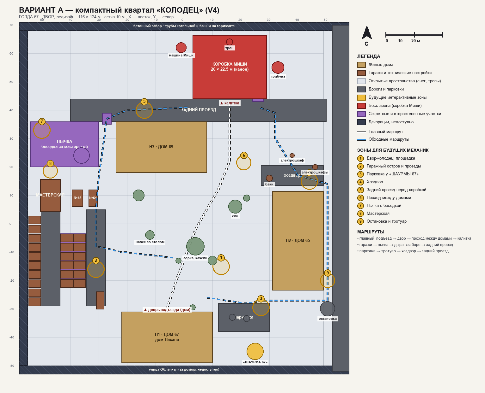
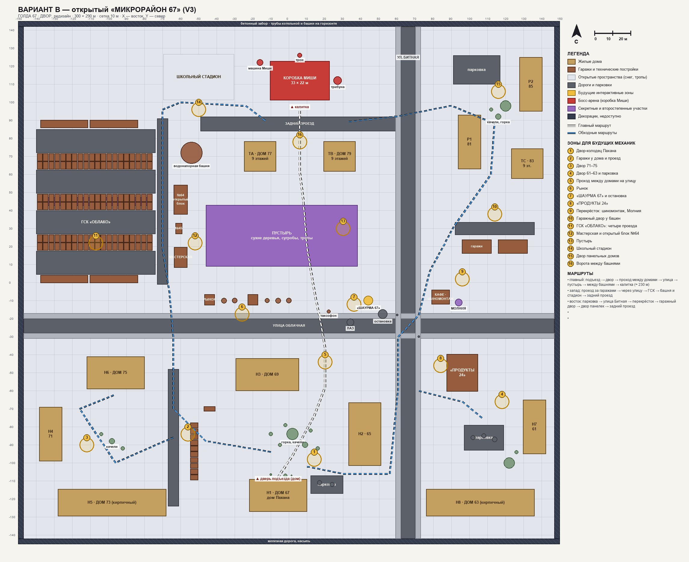
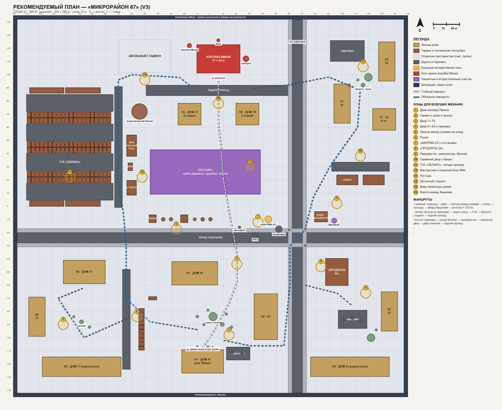

# ДВОР, редизайн V3 — планировка

Координаты: метры, X — восток, Y — север (в Godot `x = X`, `z = −Y`). Сетка на планах — 10 м. Планы строят
`tools/dvor_plan.py` (вариант A) и `tools/dvor_plan_v3.py` (вариант B и рекомендуемый), сцену — `tools/blender/dvor_scene_v3.py`.

## Вариант A — компактный квартал «КОЛОДЕЦ», 116 × 124 м

Три дома замыкают один двор, гаражи на западе, улица на востоке, коробка Миши за северным домом. Подробно — `DVOR_TOPDOWN_DESIGN.md`.
План остался от первой фазы: на нём ещё отмечена секция с аркой из игры, которая в V3 отклонена по стилю.

- Плюсы: плотно, быстро читается, мало бега.
- Минусы: один двор — мало для «настоящего района»; владелец попросил в 5–6 раз больше.

## Вариант B — открытый «МИКРОРАЙОН 67», 300 × 290 м (рекомендуется)

Две улицы крестом — Облачная (запад–восток, Y = −24) и Битная (юг–север, X = 66) — делят район на четыре квартала.

### Кварталы и здания

| Квартал | Здания (центр X, Y · основание) | Модель |
|---|---|---|
| Юг, центр — двор Пахана | H1 дом 67 (−6, −118 · 32 × 18); H2 дом 65 (42, −84 · 18 × 35); H3 дом 69 (−12, −51 · 35 × 18); 10 гаражей (X = −52,5); гараж в граффити | `res_block_a/b`, `garage_tin_*`, `garage_shell_graffiti` |
| Юго-запад — двор 71–75 | H4 (−132, −84 · 12,5 × 30, 7 этажей); H5 кирпичный (−98, −122 · 60 × 15); H6 (−96, −50 · 32 × 18) | `res_panel_7`, `res_brick_5`, `res_block_a` |
| Юго-восток — двор 61–63 | H7 (136, −80, 7 этажей); H8 кирпичный (106, −122 · 60 × 15); «ПРОДУКТЫ 24» (96, −50 · 17,5 × 20,6) | `res_panel_7`, `res_brick_5`, `shop_house` |
| Улица Облачная | рынок: два павильона и пять киосков (X от −44 до 0, Y ≈ −10); таксофон; «ШАУРМА 67» (44, −10); остановка и автобус | `kiosk_90s`, `kiosk_rusty`, `kiosk_blue`, `kiosk_grey`, `payphone`, `bus_stop_blue`, `bus_laz` |
| Перекрёсток | кафе и шиномонтаж (84, −8 · 10 × 8); Молния Маккуин (94, −11); светофоры | `shop_cafe_tyre`, `mcqueen`, `traffic_*` |
| Северо-запад — ГСК «ОБЛАКО» | четыре проезда по 66 м; кирпичные ряды по краям, 120 жестяных гаражей внутри; мастерская (−60, 14); № 45; открытый блок № 64 (−60, 46); водонапорная башня (−54, 72) | `garage_row_brick`, `garage_tin_*`, `garage_brick_double`, `garage_concrete_45`, `garage_block_rusty`, `white_tower` |
| Центр — пустырь | 84 × 34 м: сухие деревья, сугробы, тропа наискось | `tree_dead_*`, `snow_pile` |
| Север — арена | девятиэтажки-ворота TA (−16, 70) и TB (28, 70), между ними проход 26 м; задний проезд; коробка Миши (6, 112 · 33 × 22); школьный стадион (−50, 114 · 39 × 25,5) | `res_panel_9`, `hockey_rink`, `pitch_fenced` |
| Северо-восток — двор панелек | P1 (100, 78), P2 (134, 110), девятиэтажка TC (132, 66); гаражный двор из двух блоков (104 и 124, 20); парковка | `res_panel_7`, `res_panel_9`, `garage_block_rusty` |

### Маршруты к Мише

1. **Главный, около 230 м:** дверь подъезда → двор → проход между домами 69 и 65 → через улицу у рынка → тропа через пустырь → между башнями → калитка.
2. **Западный:** проезд за гаражами → через улицу → проезды ГСК → водонапорная башня и стадион → задний проезд.
3. **Восточный:** парковка → улица Битная → перекрёсток с шиномонтажом → гаражный двор → двор панелек → задний проезд.

Все три сходятся в заднем проезде перед коробкой. Дворы соединены между собой проходами — можно обойти весь юг, не выходя на улицу.

### Ориентиры

Прожекторы коробки и две девятиэтажки — север. Водонапорная башня — северо-запад. Трубы котельной и башни-панельки — горизонт.
Световой короб «ШАУРМЫ 67» и остановка — центр. Вывеска «ШИНОМОНТАЖ» и красная Молния — перекрёсток. Скатная крыша магазина — юго-восток.

### Места для будущих механик (16 зон на плане)

Двор Пахана; гаражи у дома; двор 71–75; двор 61–63 с парковкой; проход на улицу; рынок; «ШАУРМА 67» и остановка; «ПРОДУКТЫ 24»;
перекрёсток; гаражный двор у башен; ГСК; мастерская и блок № 64; пустырь; стадион; двор панелек; ворота между башнями.
Это только география: бои, бафы и квест с Молнией не придуманы и не утверждены.

### Что изменилось против прежнего плана C

Убраны фастфуд, долгострой, теплотрасса, котельная, секция с аркой, трансформаторная будка, воксельные дома и оранжевый ларёк.
Добавлены тротуары, гаражный двор на северо-востоке, площадки из настоящих качелей и горок, коробка из готовой модели катка (33 × 22 м вместо 26 × 22,5).

## Рекомендация

**Вариант B.** Он отвечает просьбе владельца о размере, устроен как настоящий микрорайон и собирается только из принятых по стилю моделей.

## Кадры сцены

Сумерки: `img/v3_01_main_street.png` (главная улица), `img/v3_02_home_yard.png` (двор Пахана), `img/v3_03_garages.png` (ГСК), `img/v3_04_market.png` (рынок),
`img/v3_05_hockey_rink.png` (коробка), `img/v3_06_aerial.png` (общий вид), `img/v3_07_towers_gate.png`, `img/v3_08_bus_stop.png`,
`img/v3_09_crossroads_mcqueen.png`, `img/v3_10_brick_yard.png`, `img/v3_11_wasteland.png`, `img/v3_12_panel_yard.png`, `img/v3_13_shop.png`, `img/v3_00_top.png`.
Ночь и день для сравнения: `img/v3_L_*.png`.
